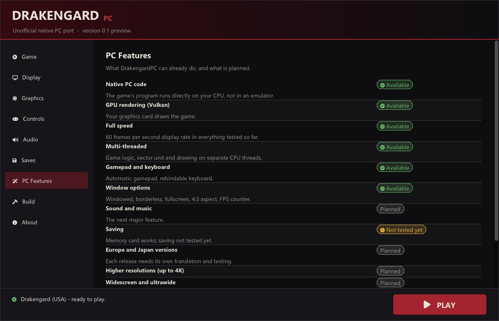
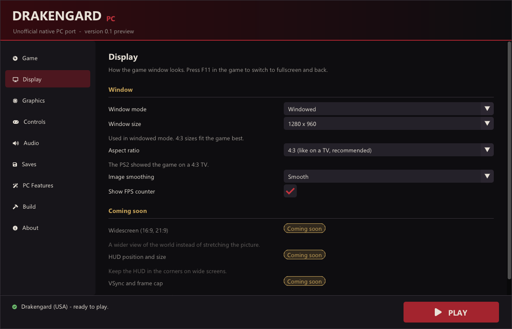
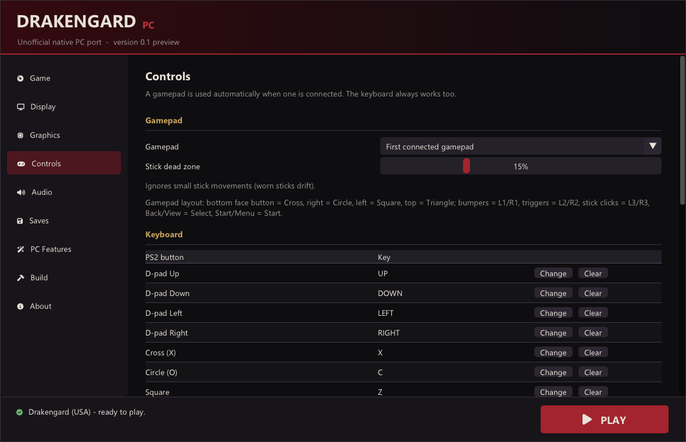

<div align="center">

# DrakengardPC

**Drakengard (PlayStation 2, 2003) running as a native Windows PC game, with its own launcher.**

*Unofficial fan project · work in progress · not affiliated with Square Enix or Cavia*

**Status: the first mission is playable at full speed. No sound yet.**



</div>

---

## What is this?

DrakengardPC turns the original PlayStation 2 game **Drakengard** into a real Windows program.

Most people play PS2 games on PC with an **emulator**: a program that pretends to be a
PlayStation 2 and reads the game's instructions one by one while it runs. DrakengardPC works
differently. Before you play, the game's code is **translated once into PC code** and compiled
like any other PC game. When you play, your **CPU runs the game directly** and your **graphics
card draws it**.

Why that matters:

- **Speed.** The game runs at full speed with a lot of CPU power left over.
- **Room to grow.** A game that is real PC code can get PC features: higher resolutions,
  widescreen, higher frame rates, modern upscaling and mods (see [What's coming](#whats-coming)).
- **Your copy, your PC.** You build it from your own disc. No game files are included here or
  downloaded from anywhere.

## Can I play it?

Partly. The project is young, and this is exactly what works today on the test PC (Intel
i5-12400F, NVIDIA RTX 3060):

| | Part of the game | State |
|:-:|---|---|
| ✅ | Start-up, logos, title screen, menus | works, full speed |
| ✅ | New Game, prologue, Chapter 1 briefing | works |
| ✅ | First mission: walking, sword attacks, HUD, map | works, full speed |
| ✅ | Gamepad and keyboard | works |
| 🟡 | Fighting enemies, the rest of the first mission | not tested yet |
| 🟡 | Dragon flight, later missions, story, endings | not tested yet |
| 🟡 | Movies (cutscene videos) | not tested yet |
| 🟡 | Saving and loading | memory card is detected; saving not tested yet |
| ❌ | Sound and music | not working yet |

**In short:** it is a preview for the curious, not yet a way to play through the game. If you
want to finish Drakengard today, use your PS2 or an emulator. Progress is tracked in
[docs/PROGRESS.md](docs/PROGRESS.md).

## The launcher

**DrakengardPC Launcher** is where everything happens: you pick your disc image, build the game
from it, change settings, and press **Play**. After that you can also start the game directly
with `DrakengardPC.exe`; it uses the same settings.

| Page | What you can do |
|---|---|
| **Game** | Choose your disc image; it is checked automatically (version and region) |
| **Display** | Windowed, borderless or fullscreen; window size; 4:3 or stretched picture; smooth or sharp pixels; FPS counter |
| **Graphics** | GPU (Vulkan) or CPU renderer; anti-aliasing (supersampling); performance options |
| **Controls** | Choose the gamepad, stick dead zone, change every keyboard key |
| **Audio** | Volume settings, ready for when sound works |
| **Saves** | Open or move the memory card folder; back it up with one click |
| **PC Features** | What works now and what is planned |
| **Build** | Checks the free build tools (and installs part of them for you), then builds the game from your disc with a progress bar |
| **About** | Credits and license |

<p align="center">


</p>

## Features

**Working now**

- Native PC code for the whole game program and its graphics programs (no emulated CPU)
- Graphics drawn on your GPU (Vulkan)
- Full speed (the PS2's 60 frames per second display rate) in everything tested so far
- Game logic, graphics processing and drawing each on their own CPU thread
- Windowed, borderless fullscreen and fullscreen; correct 4:3 picture; **F11** switches to
  fullscreen in game
- Gamepad (detected automatically) and fully rebindable keyboard
- A launcher with settings, disc check, one-click build and save backups
- Only reads your disc image; never changes it

## What's coming

Planned, in rough order. None of these exist yet.

- 🔊 Sound and music
- 💾 Saving, with automatic backups
- 🌍 The European and Japanese releases (Drakengard EU, Drag-On Dragoon)
- 🖥️ Higher resolutions (1080p, 1440p, 4K)
- ↔️ Widescreen and ultrawide
- ⚡ Higher frame rates (120/144 FPS and more)
- ✨ DLSS and FSR upscaling
- 🎮 Gamepad button remapping and mouse camera
- 🧩 Mod support (replacing textures and other files)

Details: [docs/FEATURES.md](docs/FEATURES.md).

---

## What you need

| | |
|---|---|
| **Your own copy of the game** | *Drakengard*, **USA version** (serial SLUS-20732), as a disc image (`.iso`) made from your own disc. The launcher recognises the European and Japanese releases but cannot run them yet. |
| **A Windows PC** | Windows 10 or 11 (64-bit) |
| **Processor** | Intel 4th generation (Haswell) / AMD Ryzen or newer (AVX2 needed) |
| **Graphics card** | Any recent NVIDIA, AMD or Intel GPU with up-to-date drivers (Vulkan) |
| **Disk space** | about 3 GB, plus a few GB for the free build tools |
| **Time** | plan for about an hour the first time (installing the tools and building); after that, starting the game takes seconds |

> **Why isn't there a simple download of the game?**
> The finished program contains Drakengard's code (translated). That belongs to Square Enix,
> so it can't be shared. Instead, you get the *tools* here, and they turn **your own copy** into
> the PC version on your own computer. The launcher does all the work for you.

## How to install and play

### Step 1 — Install the free tools (once)

1. **Git** — download from [git-scm.com](https://git-scm.com/download/win) and install with
   the default options.
2. **Python** — download from [python.org](https://www.python.org/downloads/windows/). In the
   installer, **tick "Add python.exe to PATH"** before you click *Install*.
3. **MSYS2** — download from [msys2.org](https://www.msys2.org/) and install it to the default
   folder `C:\msys64`. That's all; the launcher installs the compiler into it for you.

### Step 2 — Get the launcher (once)

1. Download **DrakengardPC-Launcher-….zip** from the
   [Releases page](https://github.com/brabro1/DrakengardPC/releases).
2. Extract it into an empty folder, for example `Documents\DrakengardPC`.
3. Start **DrakengardPC Launcher.exe** and press **Download DrakengardPC**. It fetches the
   project's files (about 2 minutes) into a `DrakengardPC` folder next to it.

<details>
<summary>Prefer the command line? (for developers)</summary>

```bash
git clone https://github.com/brabro1/DrakengardPC.git
```

```bash
cd DrakengardPC && python -I tools/build_game.py --launcher
```

This builds the launcher in `DrakengardPC\build\game\` (the first time it also installs the
compiler into MSYS2).

</details>

### Step 3 — Build the game from your disc (once)

In **DrakengardPC Launcher**:

1. **Game** page → *Choose disc image…* → pick your `Drakengard (USA).iso`. It should say
   **"Drakengard (USA) v1.00 – supported"**.
2. **Build** page → check that every tool says *Installed* (use *Install the build tools* if
   not) → **Build the game**. The first time takes about 15–30 minutes; the progress bar and log
   show what is happening.

### Step 4 — Play

Press **PLAY** in the launcher. You can also start `DrakengardPC.exe` (in
`DrakengardPC\build\game\`) directly; it uses the launcher's settings. Right-click it →
*Send to* → *Desktop (create shortcut)* for a desktop icon.

## Controls

A connected gamepad is used automatically (Xbox layout: A = ✕, B = ○, X = □, Y = △). Without
one, the keyboard works like this by default; every key can be changed on the launcher's
**Controls** page:

| PS2 | Keyboard |
|---|---|
| D-pad | Arrow keys |
| Left stick | W A S D |
| ✕ / ○ / □ / △ | X / C / Z / V |
| L1 / R1 | Q / E |
| L2 / R2 | 1 / 3 |
| L3 / R3 | Left Ctrl / Right Ctrl |
| Start / Select | Enter / Right Shift |
| *Fullscreen on/off* | *F11* |

## Questions

**Is this an emulator?**
No. An emulator imitates the PS2 while the game runs. Here the game's code has been translated
into PC code before you play, so your PC runs it directly. A few small support parts still
imitate PS2 hardware, mainly the console's input/output processor that runs the disc, sound and
controller drivers; they are listed in [docs/ARCHITECTURE.md](docs/ARCHITECTURE.md).

**Does this include the game?**
No. Nothing from the game is in this project. You need your own copy of Drakengard (USA).

**Which version of the game do I need?**
Drakengard for PlayStation 2, **USA release** (SLUS-20732). The launcher checks your disc
image. The European (SLES-52322) and Japanese (Drag-On Dragoon) releases are recognised but not
supported yet: every release has different program code, so each one has to be translated and
tested on its own, and that needs those discs.

**Will it run on my PC?**
It has only been tested on one PC so far (Intel Core i5-12400F, NVIDIA RTX 3060), where it
runs at full speed with plenty of power to spare. Slower PCs haven't been tried yet; reports
are welcome.

**Where are my saves and settings?**
Settings: `DrakengardPC.ini` in the DrakengardPC folder (the launcher writes it). Saves:
`work\memcard\mc0`, or the folder you choose on the **Saves** page, once saving works. Backups
made by the launcher go to `save_backups\`.

**Can I play in widescreen or at a higher resolution?**
Not yet. The game draws its original 640×448 picture; the launcher lets you show it in any
window size or fullscreen, at the correct 4:3 shape. Widescreen and higher resolutions are
planned.

**Is there a Mac or Linux version?**
Not at the moment. Windows only.

**How can I help?**
Testing on different PCs and reporting what happens is very useful. Developers: see
[docs/BUILDING.md](docs/BUILDING.md).

## Troubleshooting

| Problem | What to do |
|---|---|
| A tool shows *Missing* on the Build page | Install it (Step 1) and press *Check again*. For Python, re-run its installer and tick "Add python.exe to PATH", then restart the launcher. |
| The disc says *not supported* | Only Drakengard **USA** v1.00 (SLUS-20732) works for now. |
| The build stops with an error | The log on the Build page shows why. Press *Build the game* again after fixing it. |
| The game window is black or closes at once | Update your graphics card driver. On the Graphics page you can try the CPU renderer. |
| The game says it can't start | Open the launcher and check the Game page. The game's log is `work\logs\game.log`. |
| Something else | Note what the launcher or `work\logs\game.log` says and open an issue on the project's GitHub page. |

## Updating

Open Command Prompt in the `DrakengardPC` folder and run `git pull`. Then press **Rebuild the
game** on the launcher's Build page. New launcher versions appear on the
[Releases page](https://github.com/brabro1/DrakengardPC/releases).

---

## Learn more

- [docs/PROGRESS.md](docs/PROGRESS.md) — what has been done, with measurements
- [docs/FEATURES.md](docs/FEATURES.md) — every feature, planned or done
- [docs/COMPATIBILITY.md](docs/COMPATIBILITY.md) — what was tested, and on which PCs
- [docs/ARCHITECTURE.md](docs/ARCHITECTURE.md) — how the port works inside
- [docs/BUILDING.md](docs/BUILDING.md) — building by hand, options, tests (for developers)

## Credits

- [PS2Recomp](https://github.com/ran-j/PS2Recomp) by ran-j and contributors: the
  recompiler this port is built on
- [paraLLEl-GS](https://github.com/Arntzen-Software/parallel-gs) by Arntzen Software: the GPU
  graphics renderer
- [Drakengard1Recompile](https://github.com/k1gs/Drakengard1Recompile) by k1gs: a related
  project whose fixes helped this one
- [PCSX2](https://pcsx2.net/): used as the reference for how the PS2 behaves
- [Dear ImGui](https://github.com/ocornut/imgui), [raylib](https://www.raylib.com/) and
  [Font Awesome](https://fontawesome.com/): the launcher's interface

## License and legal

DrakengardPC's source code is free software under the **GNU General Public License v3.0**
([LICENSE](LICENSE)). Other components keep their own licenses
([THIRD_PARTY_NOTICES.md](THIRD_PARTY_NOTICES.md)).

Drakengard is © Square Enix. This is an unofficial fan project. It is not made, approved or
supported by Square Enix or Cavia, and it contains no part of the game. Please buy the game.
